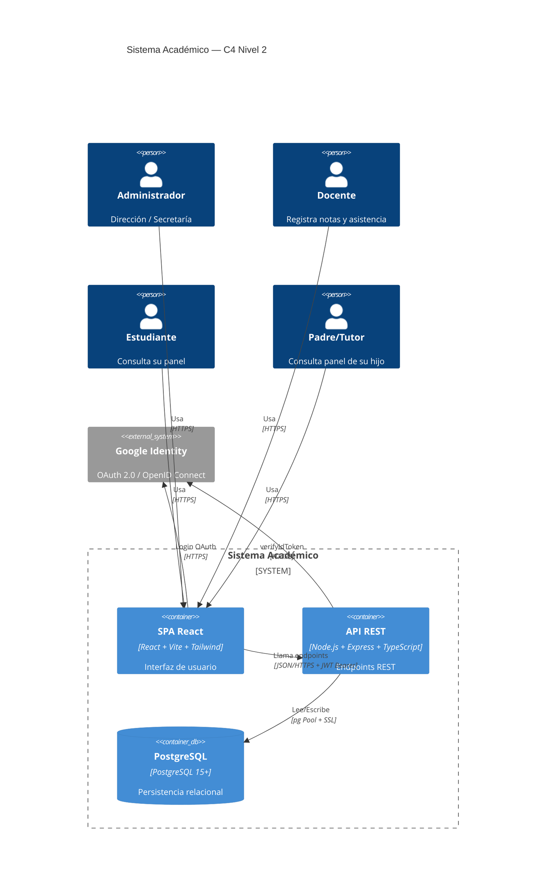
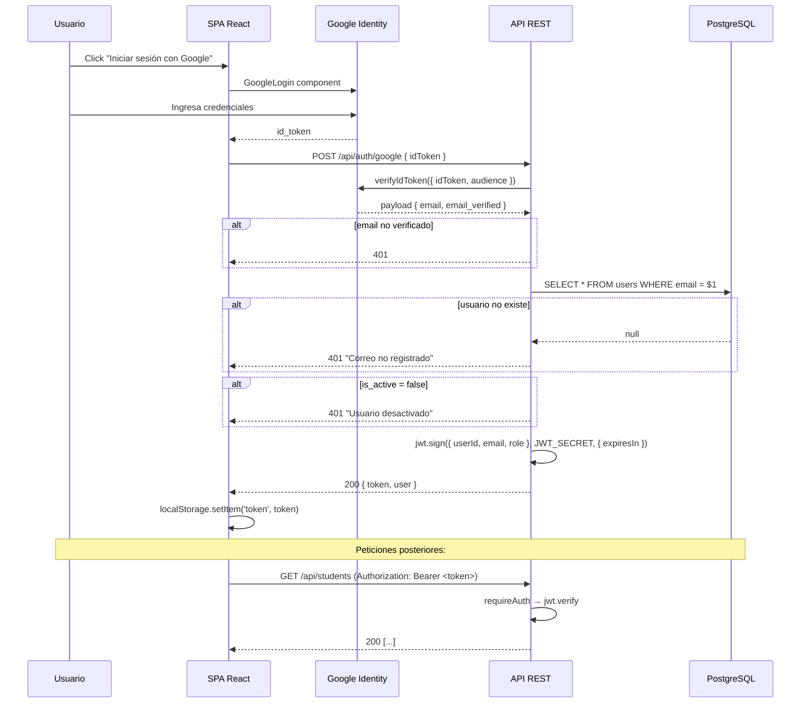
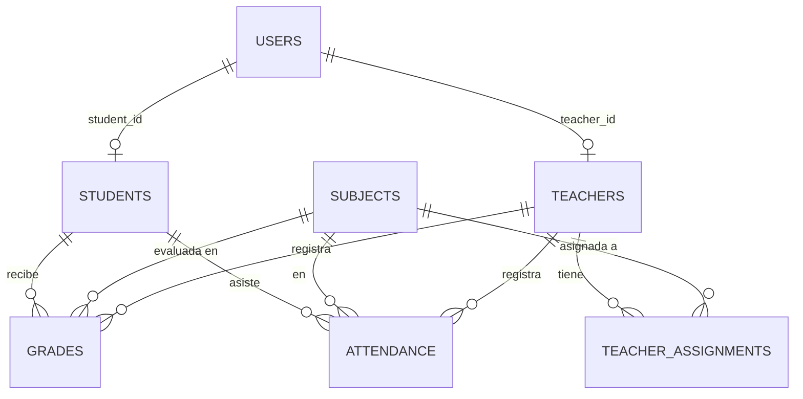
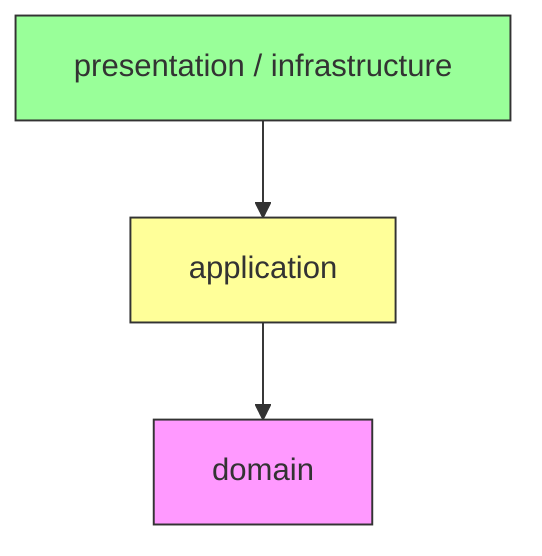
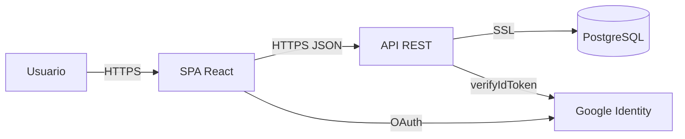

# 10 — Diagramas

## 10.1 Diagrama C4 — Nivel 2 (Contenedores)

## 10.2 Diagrama de secuencia — Autenticación OAuth + JWT

## 10.3 Diagrama entidad-relación

## 10.4 Diagrama de capas (Clean Architecture)

## 10.5 Diagrama de despliegue

