# 06. Prototipo y Validación

Este documento contiene la presentación visual del prototipo del **Sistema Académico**, organizando las capturas de pantalla de la interfaz con sus respectivas descripciones y validaciones.

---

## 1. Capturas del Prototipo y Descripción de Interfaces

### 1.1 Inicio de Sesión y Autenticación

<figure>
  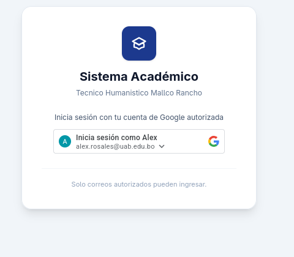
  <figcaption><i>Figura 1: Pantalla principal de autenticación de usuarios.</i></figcaption>
</figure>

---

<figure>
  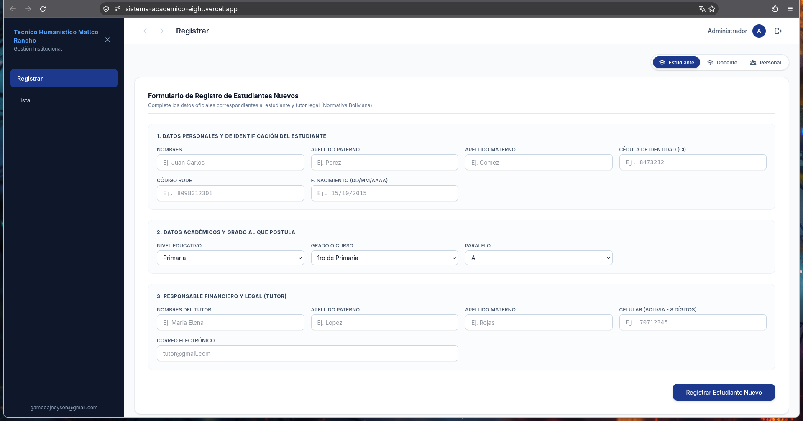
  <figcaption><i>Figura 2: Interfaz para recuperación y restablecimiento de credenciales.</i></figcaption>
</figure>

---

### 1.2 Panel Principal (Dashboard)

<figure>
  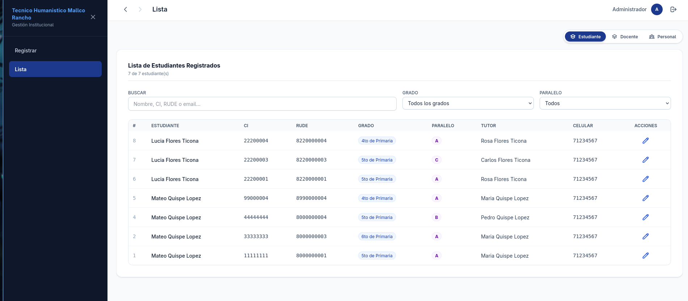
  <figcaption><i>Figura 3: Panel de control general con métricas principales.</i></figcaption>
</figure>

---

<figure>
  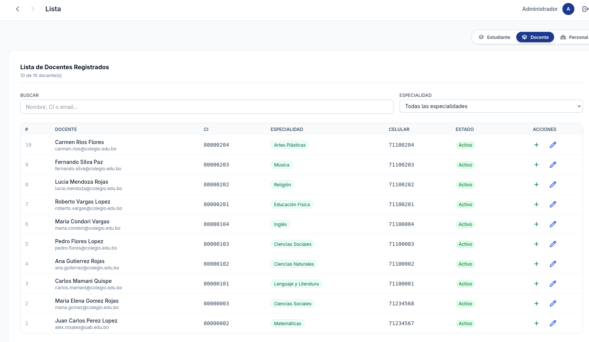
  <figcaption><i>Figura 4: Menú lateral de navegación y perfil del usuario activo.</i></figcaption>
</figure>

---

### 1.3 Gestión de Estudiantes y Docentes

<figure>
  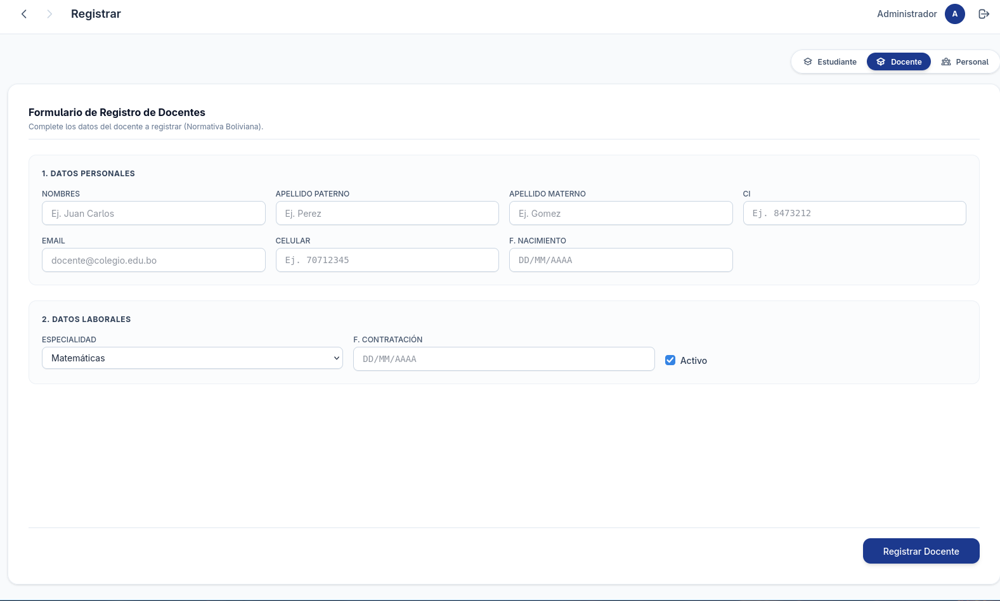
  <figcaption><i>Figura 5: Vista de tabla con el listado completo de estudiantes registrados.</i></figcaption>
</figure>

---

<figure>
  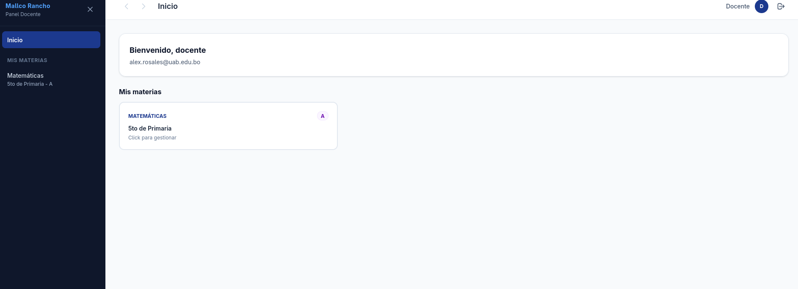
  <figcaption><i>Figura 6: Formulario modal para la inscripción de nuevos estudiantes.</i></figcaption>
</figure>

---

<figure>
  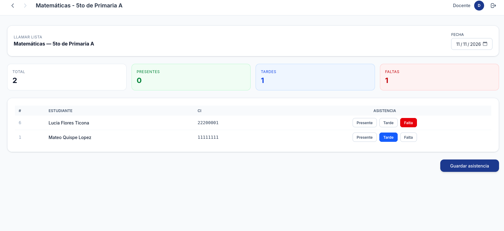
  <figcaption><i>Figura 7: Expediente completo del alumno y estado académico.</i></figcaption>
</figure>

---

### 1.4 Gestión Académica y Asignación de Cursos

<figure>
  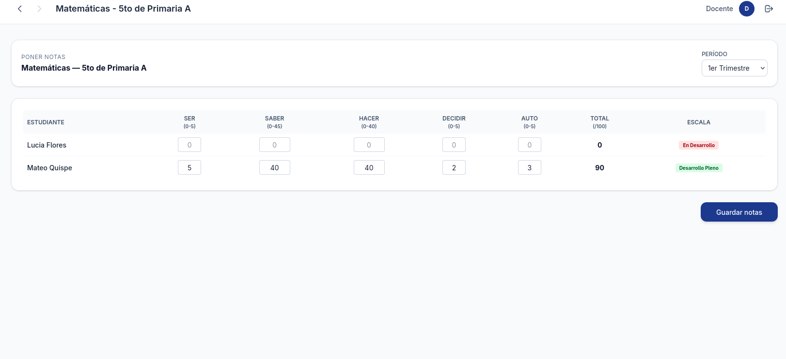
  <figcaption><i>Figura 8: Catálogo de materias y asignación de carga horaria.</i></figcaption>
</figure>

---

<figure>
  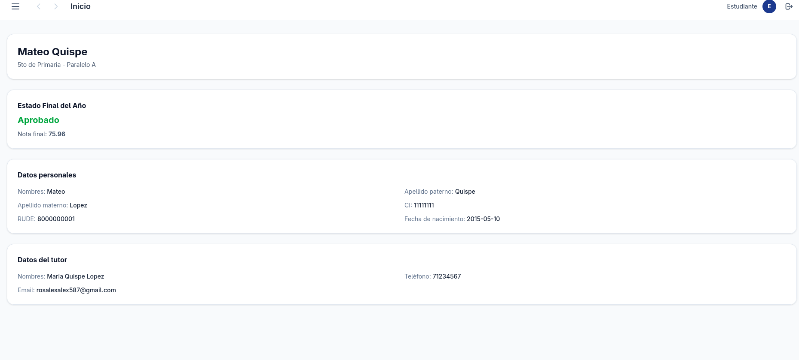
  <figcaption><i>Figura 9: Interfaz para matriculación en asignaturas por periodo.</i></figcaption>
</figure>

---

<figure>
  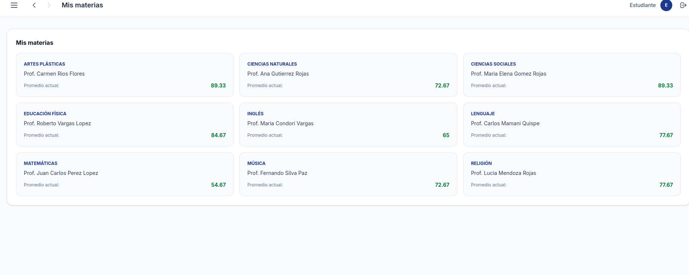
  <figcaption><i>Figura 10: Vista semanal del calendario y horarios de clases.</i></figcaption>
</figure>

---

### 1.5 Calificaciones y Evaluaciones

<figure>
  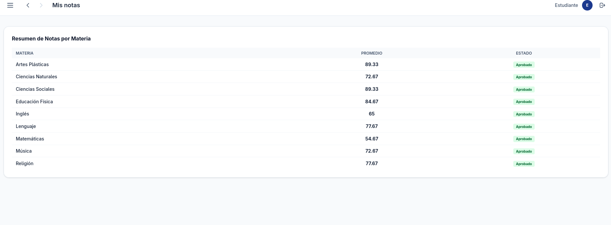
  <figcaption><i>Figura 11: Módulo de carga y modificación de calificaciones por docente.</i></figcaption>
</figure>

---

<figure>
  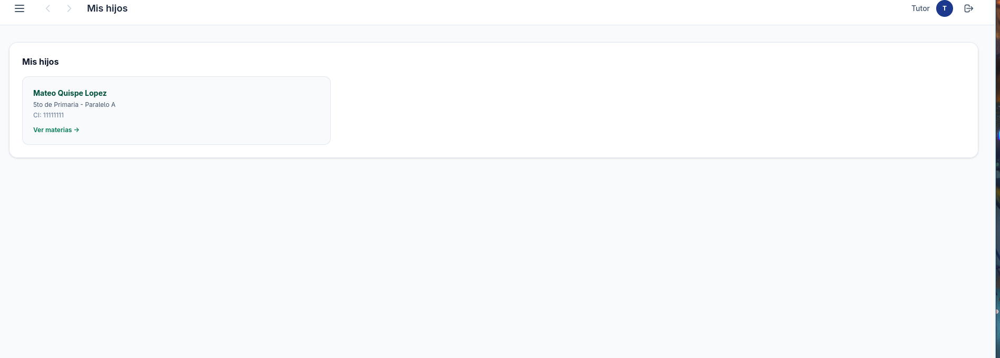
  <figcaption><i>Figura 12: Vista resumida del rendimiento escolar y promedio acumulado.</i></figcaption>
</figure>

---

### 1.6 Reportes y Configuración

<figure>
  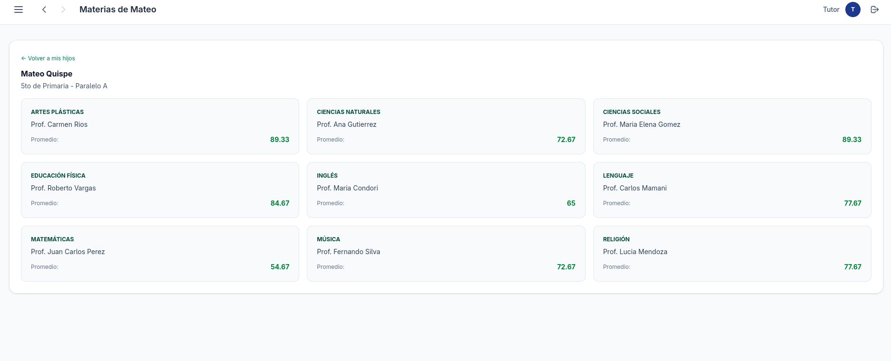
  <figcaption><i>Figura 13: Panel para exportar reportes en PDF y Excel.</i></figcaption>
</figure>

---

<figure>
  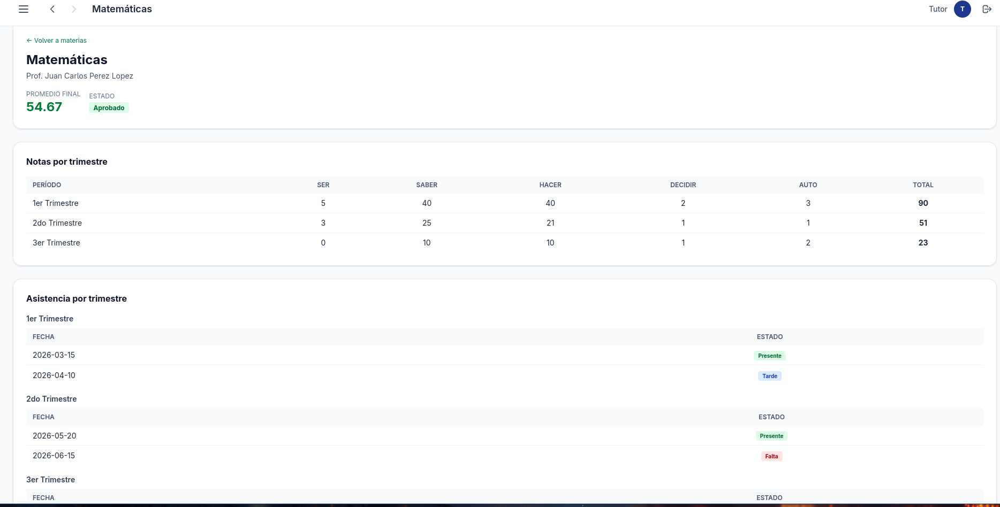
  <figcaption><i>Figura 14: Ajustes globales de parámetros y roles de usuario.</i></figcaption>
</figure>

---

## 2. Matriz de Cobertura de Capturas

| Imagen | Módulo / Sección | Estado |
| :--- | :--- | :---: |
| `cap_1.png` | Autenticación - Login | ✅ Validado |
| `cap_2.png` | Autenticación - Recuperar Clave | ✅ Validado |
| `cap_3.png` | Dashboard - Resumen | ✅ Validado |
| `cap_4.png` | Navegación - Menú Lateral | ✅ Validado |
| `cap_5.png` | Estudiantes - Lista | ✅ Validado |
| `cap_6.png` | Estudiantes - Registro | ✅ Validado |
| `cap_7.png` | Estudiantes - Expediente | ✅ Validado |
| `cap_8.png` | Cursos - Catálogo | ✅ Validado |
| `cap_9.png` | Matriculación | ✅ Validado |
| `cap_10.png` | Horarios | ✅ Validado |
| `cap_11.png` | Calificaciones - Carga | ✅ Validado |
| `cap_12.png` | Calificaciones - Boletín | ✅ Validado |
| `cap_13.png` | Reportes - Exportación | ✅ Validado |
| `cap_14.png` | Configuración - Ajustes | ✅ Validado |